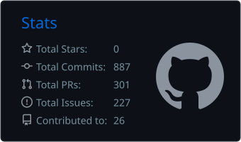
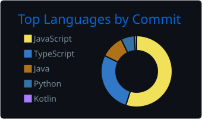

### Hi, I'm strfunctionk

Node.js 백엔드 개발을 주로 하고, 웹과 Spring Boot도 다룹니다. Python 서버도 개발할 수 있습니다.
명지대학교 컴퓨터공학과에 재학 중이며, UMC 11기 중앙 PE 파트장으로 활동하고 있습니다.

---

### Projects

**DeVine** 개발자와 PM을 연결하는 IT 협업 커뮤니티 플랫폼. 제5회 창의적 SW프로그램 경진대회 장려상

- [DeVine_BackEnd](https://github.com/DeVine-2025/DeVine_BackEnd)
- [DeVine_AI](https://github.com/DeVine-2025/DeVine_AI)
- [DeVine_FrontEnd](https://github.com/DeVine-2025/DeVine_FrontEnd)

**Memo** 초경량 로컬 퍼스트 크로스플랫폼 메모 앱. [서비스](https://memo.devnoco.com/), [소개 보기](https://github.com/devnoco)

---

수상 내역

 

- 제5회 창의적 SW프로그램 경진대회, 장려상 (DeVine) (2026.10)
- DEPth 4th 데모데이, 우승 (2026.02)
- 제12회 전국 ICT융합 공모전, 우수상 (2025.11)
- 제23회 임베디드SW 경진대회 일반 부문(자유공모부문), 은상 (2025.11)
- 제4회 창의적 SW프로그램 경진대회 AI응용부문, 대상 (2025.09)
- UMC 8th 데모데이, 장려상 (2025.08)
- UMC 7th 데모데이 우수상, Node.js Best 파트원상 (2025.02)

학생회와 동아리 활동

 

- UMC 11기 중앙 PE 파트장
- UMC 11기 백엔드 워크북 TF, 현업자와 함께 제작
- UMC 9기 (2025.08 ~ 2026.02): 중앙 TF팀 Node.js 부원, 명지대학교 부회장, Node.js 파트장, Web 파트장, Spring Boot 챌린저
- UMC 8기 (2025.02 ~ 2025.08): 지부 TF팀 Node.js 담당, 명지대학교 회장, Web 챌린저
- UMC 7기 (2024.09 ~ 2025.03): Node.js 챌린저
- 명지대학교 제17대 컴퓨터공학전공 학생회 CONNECT, 기획차장 (2026.01 ~)
- 명지대학교 2026학년도 인문캠퍼스 창업동아리 (2026.03 ~)
- 명지대학교 로봇, 임베디드 동아리 RATS (2022.04 ~)
- 명지대학교 학술스터디 그리고 (2022.03 ~)

---

### GitHub Stats

  
  

